 

 

 

 
 <a href="https://github.com/Lostky01/evToenTickets"><b>[ MISSION 01 : evToenTickets ]</b></a> &nbsp;|&nbsp; <a href="https://github.com/Lostky01/JarvisTerminalAssistant-public"><b>[ MISSION 02 : Jarvis Terminal Assistant ]</b></a> 
 
  
 
  

